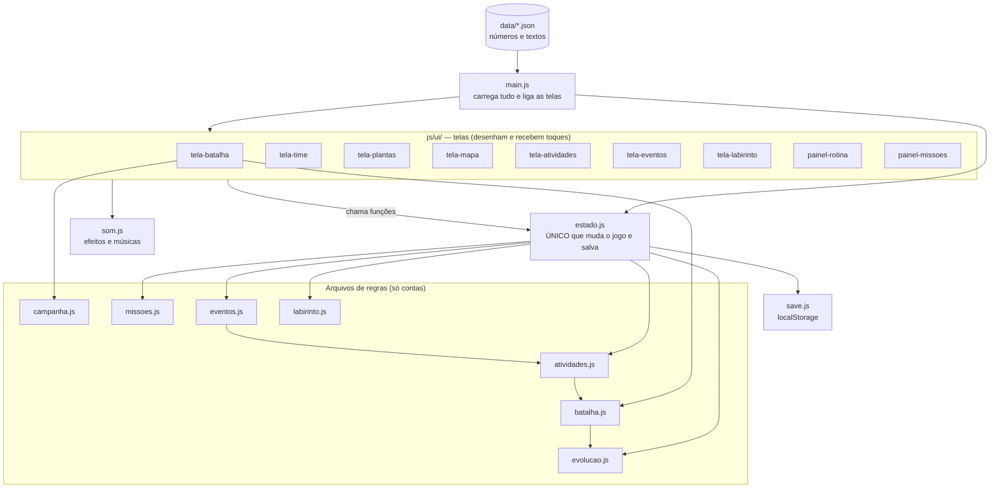

# Wiki do Horta Selvagem

Documentação de como o jogo funciona por dentro e como as partes se conectam. Escrita pra você consultar sozinho, sem depender de ninguém.

> Esta pasta é uma "wiki" dentro do próprio repositório. No GitHub, cada página abre formatada, os links funcionam e a busca encontra o texto (veja "Como pesquisar").

## Como pesquisar

- **Nesta pasta, no GitHub:** aperte a tecla `/` (ou clique na lupa no topo) e digite a palavra. Exemplo: `seiva`, `fôlego`, `orvalho`, `registrarBatalha`.
- **Pelo nome de um arquivo:** aperte `t` na página do repositório e comece a digitar (`estado.js`, `labirinto`).
- **Dentro de uma página:** use o sumário (ícone de lista no canto superior direito do texto) ou `Ctrl+F`.
- **Dúvida de "onde fica X?":** comece pelo [Mapa de conexões](#mapa-de-conexões) abaixo e pelo [Glossário](15-glossario.md).
- **Quer mudar algo?** Veja [Receitas: como faço pra…](14-receitas.md).

## Índice

| Página | Assunto |
| --- | --- |
| [01 · Visão geral e arquitetura](01-visao-geral.md) | Pastas, como o jogo liga, quem fala com quem |
| [02 · Estado e save](02-estado-e-save.md) | Tudo que é guardado, `estado.js`, `save.js`, contadores |
| [03 · Batalha](03-batalha.md) | Regras, fórmulas, habilidades, status, eventos |
| [04 · Evolução das plantas](04-evolucao.md) | Nível, estrelas, ascensão, talentos, equipamentos, pacote |
| [05 · Campanha, Pesadelo e missões](05-campanha-e-missoes.md) | Mapas, fases, estrelas, Dona Flora |
| [06 · Atividades (Desafios)](06-atividades.md) | Torre, Desafio do Dia, Horta de Treino |
| [07 · Rotina diária](07-rotina.md) | Broto, fôlego, canteiro, expedição, calendário |
| [08 · Eventos e coleção](08-eventos.md) | Invasão de Chefe, Feira, Herbário |
| [09 · Labirinto das Raízes](09-labirinto.md) | Corrida de 8 andares |
| [10 · Interface (telas)](10-interface.md) | Telas, arquivos `js/ui/`, `index.html` |
| [11 · Som e música](11-som-e-musica.md) | Efeitos, status, músicas por tela |
| [12 · Arquivos de dados (`data/`)](12-dados.md) | O que tem em cada `.json` e quem usa |
| [13 · PWA, versão e publicação](13-pwa-e-publicacao.md) | Service worker, offline, versão, GitHub Pages |
| [14 · Receitas](14-receitas.md) | Passo a passo de tarefas comuns |
| [15 · Glossário](15-glossario.md) | Termos do jogo e do código |

## Mapa de conexões

A regra principal: **as telas (`js/ui/`) só pedem coisas; quem muda o jogo é o `estado.js`; os arquivos de regras só fazem conta.** Os números vêm de `data/*.json`.

Detalhes e a ordem em que as coisas acontecem estão em [01 · Visão geral](01-visao-geral.md).

## Estado do projeto (o que existe e o que não existe ainda)

- **Existe:** batalha, evolução, campanha + Pesadelo, missões, Desafios (Torre, Desafio do Dia, Treino), rotina (canteiro, expedição, calendário), Invasão de Chefe, Feira, Herbário, Ascensão, Talentos, Labirinto, som e PWA.
- **Ainda não existe no código:** Arena com bots (`PLANO.md`, fase 5) e Fusão de plantas (fase 14). O Herbário já mostra receitas de fusão só como informação.
- O plano e o andamento das fases estão em [`PLANO.md`](../PLANO.md).

> **Manter atualizado:** ao mudar o jogo, atualize a página correspondente aqui (regra no [`CLAUDE.md`](../CLAUDE.md)).
